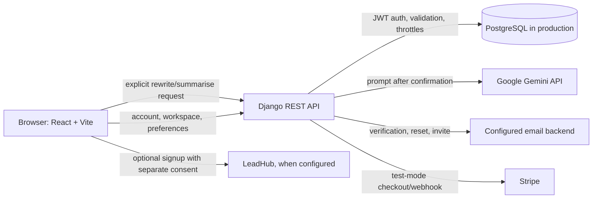

# Draftloom architecture

Current source overview (reviewed 2026-11-16). This describes the local code shape, not a production deployment attestation.

## Boundaries and controls

- Browser draft text stays in the current tab until the user confirms an AI request. The API validates request size/mode and holds workspace usage reservation in a service module.
- Account email/password hash, workspaces, role memberships, settings and usage are database-backed. The frontend uses token auth; account recovery and deletion have explicit API routes.
- AI provider key and payment secrets are server-side environment configuration. Do not expose secrets in Vite variables.
- Product marketing email is distinct from required verification/recovery mail. Optional signup capture uses double opt-in and portfolio-wide LeadHub suppression when the HTTPS service is configured.
- Static free tools run in the browser and do not upload the draft. Optional email signup sends only the address, consent, product id and page path.
- Protected terminology is saved on the workspace only by its owner; anonymous terms stay in session storage. On a rewrite request, the API uses the authenticated workspace glossary (not client-supplied replacements), or accepts anonymous session terms, and rejects generated output that changes a source term's spelling or capitalization. Terms are passed to Gemini as literal data, not trusted as instructions.

## Decisions and gaps

- Keep existing product accounts isolated until a dedicated OIDC provider and per-app security review are completed. LeadHub is not an identity provider.
- Stripe stays test-only until the full signed webhook, cancel/refund, tax, support, and live account review pass.
- Render deployment configuration exists; database backups, restore evidence, live sender, monitor alerts, production browser flow and current revision are not verified by this document.
- LeadHub signup is hidden until an approved HTTPS endpoint is set in the static tools' `meta[name="leadhub-base-url"]`. The owner must also approve public privacy text and verify sender/domain before enabling it.
