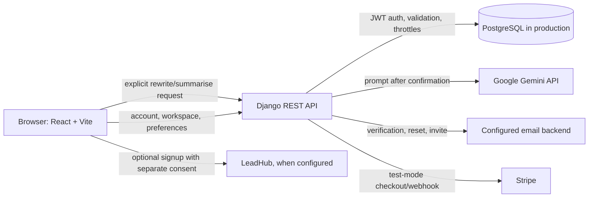

# Draftloom architecture

Current source overview (reviewed 2026-11-17). This describes the local code shape, not a production deployment attestation.

## Boundaries and controls

- Browser draft text stays in the current tab until the user confirms an AI request. The API validates request size/mode and holds workspace usage reservation in a service module.
- Account email/password hash, workspaces, role memberships, settings and usage are database-backed. The frontend uses token auth; account recovery and deletion have explicit API routes.
- Workspace style-guide history stores only voice guidance and reusable phrases. Changed saves/restores snapshot the prior values in a transaction; owners can inspect the latest ten, and the newest twenty are retained. Protected terms are excluded.
- Review packets are rendered and downloaded in the browser as standalone HTML, with no server request or third-party assets. Reviewers mark a decision/comment and print to PDF; the user shares the returned file through their own channel.
- Message templates are stored as bounded JSON on the workspace and edited only by its owner. Placeholder names are restricted to lowercase letters, digits, and underscores; values are inserted as plain draft text in the current browser tab.
- Draft and previous-draft autosaves stay in `sessionStorage`; the selected 15-minute, 4-hour or 24-hour window is stored as a non-sensitive browser preference. Expiration is checked when loading and every 30 seconds while the page is open; closing the tab clears both drafts.
- Before a Gemini request, the browser can identify email addresses, phone-like values and common API-token patterns. Redaction is opt-in, performed locally immediately before the request, and leaves the local draft unchanged. Pattern detection is best-effort and is not a privacy guarantee.
- Browser offline events disable new rewrite requests and tell the user to retry manually after reconnecting. There is no background request queue, avoiding surprise sends or duplicate processing.
- AI provider key and payment secrets are server-side environment configuration. Do not expose secrets in Vite variables.
- Product marketing email is distinct from required verification/recovery mail. Optional signup capture uses double opt-in and portfolio-wide LeadHub suppression when the HTTPS service is configured.
- Static free tools run in the browser and do not upload the draft. Optional email signup sends only the address, consent, product id and page path.
- Protected terminology is saved on the workspace only by its owner; anonymous terms stay in session storage. On a rewrite request, the API uses the authenticated workspace glossary (not client-supplied replacements), or accepts anonymous session terms, and rejects generated output that changes a source term's spelling or capitalization. Terms are passed to Gemini as literal data, not trusted as instructions.
- The optional context brief (reader, goal, supported facts to keep, avoid list) stays in page memory and is sent only after the same explicit processing confirmation as the draft. The API bounds fields and treats them as contextual data; it never allows them to add unsupported facts.
- Optional change rationales use Gemini's JSON response schema. The API verifies quoted source and revised sentences are exact substrings before returning paired positions; unlinked or malformed explanations are rejected. The UI labels rationales as AI explanations and can select the matching source sentence; this is not fact verification.
- English variant is a per-request enum (International by default; India, UK, or US optional). It changes spelling/idiom only, and the server prompt explicitly preserves names, dates, currencies, units, facts, intent, commitments, and protected terms. It is not saved to the workspace.

## Decisions and gaps

- Keep existing product accounts isolated until a dedicated OIDC provider and per-app security review are completed. LeadHub is not an identity provider.
- Stripe stays test-only until the full signed webhook, cancel/refund, tax, support, and live account review pass.
- Render deployment configuration exists; database backups, restore evidence, live sender, monitor alerts, production browser flow and current revision are not verified by this document.
- LeadHub signup is hidden until an approved HTTPS endpoint is set in the static tools' `meta[name="leadhub-base-url"]`. The owner must also approve public privacy text and verify sender/domain before enabling it.
